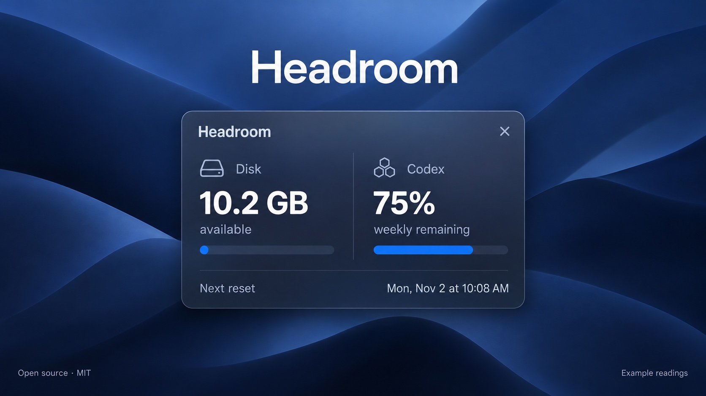

# Headroom

I made Headroom because I kept checking the same two things: available disk space and my remaining Codex allowance or credits. It keeps both in the Mac menu bar, with an optional floating card you can put where you want it.

The card shows when your allowance resets, including the date and local time. You can drag it by the heading or readings and close it when you're done. Floating starts off each time you launch the app.



The image above is an illustration with example readings of weekly allowance mode.

## What it shows

- Available disk space, refreshed every 30 seconds.
- Remaining weekly Codex allowance or credit balance, refreshed about once a minute.
- The date and local time of the next weekly reset.
- An optional floating card you can drag around, plus launch at login.

The floating card starts off at launch. You can hide the menu bar numbers and keep just the icon if you prefer.

## Switch between allowance and credits

Turn on **Show credits** in the menu to replace the weekly percentage with credits left in both the menu bar and floating card. Headroom remembers your choice. Turn it off to return to weekly allowance and the next reset date.

Credit balances show up to two decimal places. They are credits, not a dollar amount. An unlimited balance shows ∞. Missing balances stay unavailable rather than becoming zero.

## Adaptive pacing

Turn on **Show pacing** in weekly allowance mode to see **Daily pace** and **Today remaining** in the card. The menu bar shows disk space, weekly allowance, and today’s remaining budget, such as `24 GB · 60% · 80.0% today`. Turning pacing off removes the extra daily budget from the menu bar. Daily pace is percentage points of your full weekly allowance per day. For example, 60% remaining with four days until reset gives a daily pace of 15%. Today remaining is the percentage of today’s budget left: it starts at 100%, counts down as you use the budget, and resets at local midnight. If no allowance remains above your reserve, it shows 0%.

Daily pace divides the allowance still available by the exact time until reset and adjusts as you use more or less. Today remaining counts down against a budget set at the first reading of each local day. A light day leaves more for later days; overspending today does not immediately refill today's budget. Starting partway through a day prorates that day's budget. The last partial day can use everything left above your reserve.

**Reserve** sets how much weekly allowance to leave at reset, from 0% to 100%, and defaults to 0%. Changing it recalculates the rest of today's budget. Pacing hides in credits mode and stays unavailable when weekly readings are missing, stale, or awaiting a new reset.

For example, `80% today` means four fifths of today’s budget remains.

The app saves one daily budget anchor locally so restarting does not refill today's budget. It does not save a growing usage history or make additional network requests. A new weekly window, time-zone change, or replenished allowance starts a new budget.

## Requirements

- macOS 14 or later.
- Xcode with Swift 6 or later for building.
- Codex CLI signed in with your ChatGPT account, installed at `/opt/homebrew/bin/codex`, `/usr/local/bin/codex`, or `~/.local/bin/codex`.

## Build and run

Clone this repository, then run these commands from its folder:

```sh
swift test
./script/build_and_run.sh --verify
```

Headroom appears in the menu bar. There is no Dock icon. The menu lets you show the floating card, hide the numbers in the menu bar, refresh, or quit.

The script creates `dist/Headroom.app` with a local ad-hoc signature. This is a source build, not a notarized download. There are no third-party Swift packages to install.

To build without launching or stopping the app:

```sh
./script/build_and_run.sh --build-only
```

## Launch at login

```sh
./script/install_login.sh
```

This installs Headroom in `~/Applications`, enables launch at login through macOS ServiceManagement, and opens it. If macOS asks for approval, enable Headroom in **System Settings > General > Login Items**. You can turn automatic startup off there too.

Run the installer again after code changes to update the installed copy. A regular build only updates `dist/Headroom.app`. If the destination contains an app with a different bundle identifier, the installer stops so you can resolve the conflict first.

## Readings and privacy

Disk space updates every 30 seconds. It uses macOS's available-capacity estimate, including space reclaimable for important usage, so it can differ from `df`. It does not scan your folders.

Codex usage updates about once a minute, with slower retries when the connection fails. Headroom selects the seven-day quota window and shows the remaining percentage and next reset in allowance mode. Credit mode uses the balance from the same response, so switching displays adds no network requests. Only full read responses replace the readings; partial notifications cannot erase a known balance. Failed readings are marked as stale. If your account does not report the selected reading, Headroom says so.

Headroom uses one installed Codex CLI helper over private pipes. It does not start model turns, read credential files, log account responses, or run a hosted backend. Full account responses stay in memory. The CLI handles its own authentication, network connections, configuration, and storage. Headroom stores your display choices, reserve, one daily pacing anchor, menu bar preference, and floating-card position locally. Disk readings stay on your Mac. The Codex CLI makes the authenticated network requests needed to retrieve your account allowance.

Both the app and helper contribute to resource use. There is one tolerant refresh timer and no continuous animation. Measure on your own Mac with `python3 script/measure_idle.py` if you'd like to check the cost.

## Development

```sh
./script/build_and_run.sh --preview
```

Preview mode opens the same card in a regular window for UI inspection. While Headroom is active, Command-Shift-H opens the actual menu popover. Normal launches remain menu-bar-only.

The optional `.build/debug/Headroom --probe` command checks live disk and quota readings. It prints those readings to the terminal, so review the output before sharing it.

For a floating-card drag check, record the starting position, drag the card, then verify that the position changed:

```sh
python3 script/check_drag.py record /tmp/headroom-drag.json
# Drag the floating card by its heading or readings.
python3 script/check_drag.py verify /tmp/headroom-drag.json
```

See [SECURITY.md](SECURITY.md) for the trust model and vulnerability reporting.

## License

[MIT](LICENSE). Use it, change it, and share it.

Headroom is an independent project and is not affiliated with or endorsed by OpenAI or Apple.
