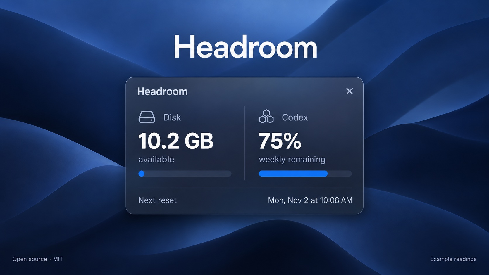

# Headroom

Headroom keeps two things in your Mac's menu bar: available disk space and your weekly Codex allowance. Click it for details, or turn on the floating card and put it where you want it.

The card shows when your allowance resets, including the date and local time. You can drag it by the heading or readings and close it when you're done. Floating starts off each time you launch the app.



## Requirements

- macOS 14 or later.
- Xcode with Swift 6 or later for building.
- Codex CLI signed in with your ChatGPT account, installed at `/opt/homebrew/bin/codex`, `/usr/local/bin/codex`, or `~/.local/bin/codex`.

## Build and run

Clone this repository, then run these commands from its folder:

```sh
swift test
./script/build_and_run.sh --verify
```

Headroom appears in the menu bar. There is no Dock icon. The menu lets you show the floating card, hide the numbers in the menu bar, refresh, or quit.

The script creates `dist/Headroom.app` with a local ad-hoc signature. This is a source build, not a notarized download. There are no third-party Swift packages to install.

To build without launching or stopping the app:

```sh
./script/build_and_run.sh --build-only
```

## Launch at login

```sh
./script/install_login.sh
```

This installs Headroom in `~/Applications`, enables launch at login through macOS ServiceManagement, and opens it. If macOS asks for approval, enable Headroom in **System Settings > General > Login Items**. You can turn automatic startup off there too.

Run the installer again after code changes to update the installed copy. A regular build only updates `dist/Headroom.app`. If the destination contains an app with a different bundle identifier, the installer stops so you can resolve the conflict first.

## Readings and privacy

Disk space updates every 30 seconds. It uses macOS's available-capacity estimate, including space reclaimable for important usage, so it can differ from `df`. It does not scan your folders.

Codex usage updates about once a minute, with slower retries when the connection fails. Headroom selects the seven-day quota window and shows the remaining percentage and next reset. Failed readings are marked as stale. If your account does not report a weekly window, Headroom says so.

Headroom uses one installed Codex CLI helper over private pipes. It does not start model turns, read credential files, log account responses, or run a hosted backend. Account responses stay in memory. The CLI handles its own authentication, network connections, configuration, and storage. Headroom stores your menu bar preference and floating-card position locally.

Both the app and helper contribute to resource use. There is one tolerant refresh timer and no continuous animation. Measure on your own Mac with `python3 script/measure_idle.py` if you'd like to check the cost.

## Development

```sh
./script/build_and_run.sh --preview
```

Preview mode opens the same card in a regular window for UI inspection. While Headroom is active, Command-Shift-H opens the actual menu popover. Normal launches remain menu-bar-only.

The optional `.build/debug/Headroom --probe` command checks live disk and quota readings. It prints those readings to the terminal, so review the output before sharing it.

For a floating-card drag check, record the starting position, drag the card, then verify that the position changed:

```sh
python3 script/check_drag.py record /tmp/headroom-drag.json
# Drag the floating card by its heading or readings.
python3 script/check_drag.py verify /tmp/headroom-drag.json
```

See [SECURITY.md](SECURITY.md) for the trust model and vulnerability reporting.

## License

[MIT](LICENSE). Use it, change it, and share it.

Headroom is an independent project and is not affiliated with or endorsed by OpenAI or Apple.
